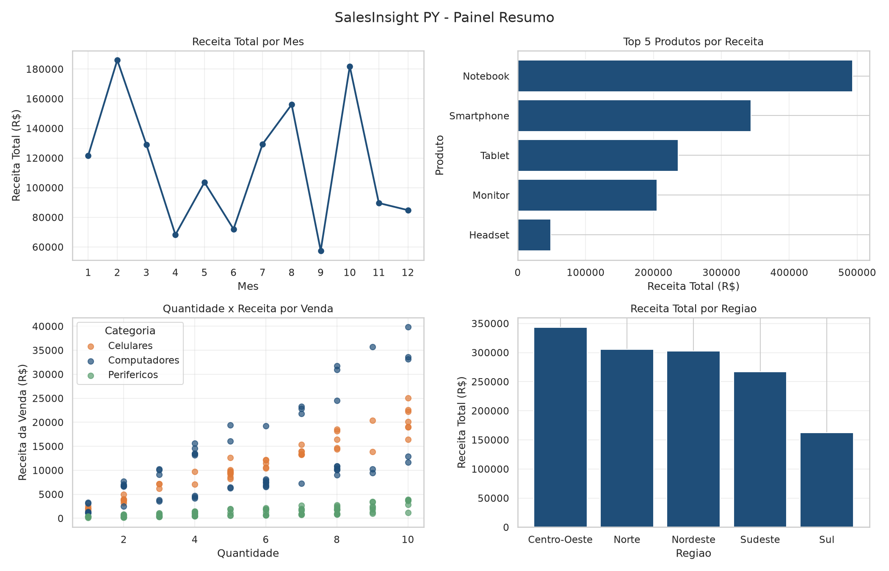

# SalesInsight PY

Análise e visualização de dados de vendas com Python.

Mini-Projeto Avaliativo — Módulo 01, Semana 07 — Desenvolvedor(a) em IA para Análise Preditiva (T5).

## Sobre o projeto

O SalesInsight PY simula o trabalho de um analista de dados júnior numa empresa de varejo: a partir de um histórico de vendas em CSV, o programa **carrega, inspeciona, limpa, transforma, agrega e visualiza** os dados, e exporta os resultados para a reunião trimestral da diretoria.

O dataset é sintético (200 registros, `seed=42`) e já traz "sujeira" proposital (datas inválidas), que o código precisa tratar antes de qualquer cálculo.

## O que o projeto analisa

- Receita, quantidade vendida e número de vendas **por mês**
- **Top 5 produtos** e receita por **categoria**
- Receita e ticket médio por **região**
- **Segmentação de clientes** por nível de gasto: Bronze (abaixo de R$ 5.000), Prata (de R$ 5.000 a R$ 15.000) e Ouro (acima de R$ 15.000)
- Relação entre **quantidade vendida e receita** de cada venda
- Exportação dos resultados em **CSV** e **JSON** e dos gráficos em **PNG**

## Principais resultados

Com o dataset gerado (`seed=42`), depois da limpeza (194 vendas válidas):

| Indicador | Valor |
|---|---|
| Receita total | R$ 1.380.210,31 |
| Ticket médio por venda | R$ 7.114,49 |
| Produto com maior receita | Notebook (R$ 493.242,63) |
| Categoria com maior receita | Computadores (R$ 698.455,24) |
| Região com maior receita | Centro-Oeste (R$ 342.981,92) |
| Região com maior ticket médio | Nordeste (R$ 8.653,08) |
| Meses de pico / vale | Fevereiro e outubro (picos) / setembro (vale) |
| Clientes por segmento | 35 Ouro, 9 Prata, 5 Bronze (49 clientes) |



## Conceitos aplicados

- **Lógica de programação:** variáveis, tipos de dados, operadores aritméticos, lógicos e relacionais, `if/elif/else`, `for`
- **Estruturas de dados:** listas, dicionários (tabelas de preços, categorias e meses) e estruturas compostas (dicionário de DataFrames com as métricas)
- **Funções:** parâmetros, retorno, docstring, **funções lambda** (3 usos em contextos distintos) e **função de ordem superior** (`processar_coluna`)
- **Classe:** `AnalisadorDeVendas`, que guarda os dados e organiza as etapas do fluxo
- **Arquivos:** leitura e escrita de **CSV** (`read_csv`, `to_csv`) e **JSON** (`json.dump`, `json.load`)
- **Módulo `datetime`** e conversão de tipos (`pd.to_datetime`, `astype`)
- **Pandas:** DataFrames, filtros com condições booleanas, `groupby`, `agg`, transformações condicionais vetorizadas
- **Matplotlib e Seaborn:** gráficos de linha, barras e dispersão, customização (título, rótulos, legenda, paleta, `figsize`), **subplots 2×2** e exportação com `savefig`
- **Git e GitHub:** branches por funcionalidade, commits descritivos e pull requests

## Como executar

1. Instale o **Python 3.10 ou superior**.
2. Instale as dependências:

   ```bash
   pip install pandas numpy matplotlib seaborn
   ```

3. Execute no terminal, dentro da pasta do projeto:

   ```bash
   python salesinsight.py
   ```

Se o arquivo `vendas.csv` não existir, o próprio programa gera o dataset. Os resultados são salvos na pasta `outputs/`.

## Como o fluxo funciona

A função `main()` cria um `AnalisadorDeVendas` e executa as etapas em ordem:

| Etapa | Método / função | O que faz |
|---|---|---|
| 1 | `carregar` | Lê o `vendas.csv` |
| 2 | `inspecionar_dados` | Mostra shape, colunas, tipos, nulos e primeiros registros |
| 3 | `transformar` | Limpa os dados (`tratar_dados`) e cria as colunas derivadas (`criar_colunas_derivadas`, `enriquecer_dados`) |
| 4 | `analisar` | Calcula as métricas com `groupby` e segmenta os clientes |
| 5 | `visualizar` | Gera as quatro figuras em PNG |
| 6 | `resumo` | Calcula as estatísticas gerais e exporta CSV e JSON |

Toda a limpeza acontece **antes** das transformações, das agregações e dos gráficos.

## Estrutura do projeto

```
salesinsight-py/
|-- salesinsight.py
|-- vendas.csv
|-- README.md
|-- outputs/
    |-- metricas_por_mes.csv
    |-- segmentacao_clientes.csv
    |-- estatisticas_gerais.json
    |-- graficos/
        |-- receita_por_mes.png
        |-- top_produtos.png
        |-- quantidade_vs_receita.png
        |-- painel_resumo.png
```

## Decisões técnicas

**Remover as datas inválidas em vez de mantê-las ou preenchê-las.** Cerca de 3% das datas do dataset vêm escritas como "DATA INVALIDA". A data é a base para agrupar as vendas por mês, trimestre e ano, então uma venda sem data não entra em nenhum desses cálculos, e inventar uma data distorceria os resultados. A conversão com `pd.to_datetime(errors="coerce")` marca o que não é data, e a função `tratar_dados` descarta essas linhas e mostra um relatório: de 200 registros, 6 foram removidos e 194 permaneceram.

**Converter os números para `float` antes de gravar o JSON.** O Pandas devolve números do NumPy, que o `json.dump` não consegue gravar. Por isso os valores são convertidos para `float` comum e arredondados para duas casas. Depois da gravação, o arquivo é lido de volta com `json.load` para confirmar que a escrita funcionou.

**Funções de gráfico que recebem o eixo (`ax`).** Cada gráfico é desenhado por uma função que recebe o `ax` como parâmetro. Assim, a mesma função gera a figura individual e também o quadrante do painel 2×2, sem repetir código.

**Uma classe para organizar o fluxo.** A classe `AnalisadorDeVendas` guarda os dados e os resultados, então cada etapa não precisa receber e devolver a tabela, e a `main()` fica como uma lista simples de passos.

## O que poderia ser melhorado

- **Faixas de segmentação:** com os cortes atuais, 35 dos 49 clientes ficaram em Ouro. Ajustar as faixas (ou usar percentis) deixaria a distribuição mais equilibrada.
- **Dados reais:** aceitar um CSV externo com as mesmas colunas, em vez de depender do dataset sintético.
- **Testes:** adicionar testes simples para as funções de limpeza e de métricas.
- **Parametrização:** receber caminhos e faixas de valor como parâmetros, em vez de deixá-los fixos no código.

## Organização do trabalho

- **Kanban:** [KANBAN.md](KANBAN.md)
- **Branches:**
  - `main`: versão final
  - `develop`: integração
  - `feat/pipeline-dados`: geração, inspeção, limpeza e colunas derivadas
  - `feat/analise-metricas`: métricas com `groupby` e segmentação de clientes
  - `feat/visualizacoes`: gráficos de linha, barras, dispersão e painel 2×2
  - `feat/classe-analisador`: função de ordem superior, exportação e classe `AnalisadorDeVendas`
  - `docs/readme`: este README
- **Commits:** mensagens no padrão *conventional commits* (`feat:`, `docs:`, `chore:`).

## Ferramentas utilizadas

- Python, VS Code
- Bibliotecas: pandas, numpy, matplotlib, seaborn, json, datetime, os, random
- Git e GitHub (branches e pull requests)

## Vídeo de demonstração

[inserir o link do Google Drive ou do YouTube aqui]
